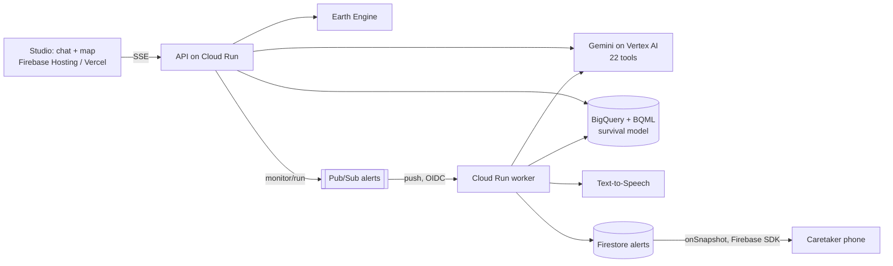

# ReRoot

**Plant trees where they will survive, then prove they did. And prove the water came back, too.**

Google Cloud AI Builder Cup 2026 · **Sustainability & Social Impact**

| | |
|---|---|
| **Live app** | **https://reroot-hack-2026.web.app** (Firebase Hosting) · same app at **https://rerootearth.com** (Vercel) |
| Demo video (3:09) | _link added at submission_ |
| Pitch deck | _link added at submission_ |
| API (Cloud Run) | https://api-152511810602.us-central1.run.app/health |
| Evaluation | [EVALUATION.md](EVALUATION.md) |

## In brief

ReRoot is a chat-first planning and proof platform for nature commitments. When a highway, mine or
data centre takes forest or water, Indian law and corporate pledges require the loss to be made good
somewhere else. Planting is counted; survival rarely is. Lakes get funded; nobody checks they hold water.

A **Gemini agent on Vertex AI** (22 tools, plans its own steps) works with satellite data from **Earth
Engine** and a **BigQuery ML survival model**. It ranks one-hectare cells where saplings will survive,
writes the compensatory planting plan, and then keeps watching. Monthly satellite greenness plus
live weather trigger **Pub/Sub** alerts. Gemini writes them in Hindi, and **Cloud Text-to-Speech** turns them
into voice notes. Every alert is written to **Firestore**, and the caretaker's phone in Studio subscribes with the
**Firebase SDK**, so it arrives the moment it's created. The same engine screens data centres for water
risk and verifies water-replenishment lakes from Sentinel-1 radar, every month since 2018, rain-adjusted.

**How we use the required stack:**
- **Gemini (Vertex AI):**
  - the agent, with tool calling, its own step plans, grounded answers and Hindi alert writing;
  - plan drafting;
  - photo verification of plantations (vision).
- **Cloud Run:**
  - the API, including the Pub/Sub push worker that composes alerts;
  - the `region-builder` job that builds a new region's satellite grid on demand.
- **Firestore:** the real-time field-alert feed (`alerts`) and the photo-check log (`photo_verifications`), with
  [security rules](firestore.rules): public read for the demo feed, no client writes.
- **Firebase:**
  - the Firebase Web SDK in Studio, a live `onSnapshot` subscription on the caretaker phone;
  - **Firebase Hosting** for the Studio.

## The five stops (what the demo shows)

1. **Find planting sites.** A developer describes a project, e.g. a 14 km Aravalli bypass. ReRoot measures what it
   clears: 106 ha of tree cover, 3,541 t CO₂e. It then ranks 78,000+ one-hectare cells and returns 11 sites (115 ha). No site is on
   farmland, existing forest or grassland, and each comes with native species and its reasons.
2. **Write the plan.** A compensatory afforestation plan (1,26,500 saplings, schedule, monitoring, risks, map),
   with every number sourced.
3. **Monitor and alert.** Each plantation's satellite greenness is compared with what a healthy plantation of its age
   should show, plus a 10-day rain forecast and soil moisture. At-risk sites trigger Pub/Sub alerts, which arrive
   as Hindi voice notes through Firestore. Caretakers reply with a photo, which Gemini checks.
4. **Screen a data centre.** Water stress (WRI Aqueduct), groundwater trend (NASA GRACE), cooling hours (ERA5-Land)
   and cooling water by design. It then builds a resource loop: treated wastewater, nearby solar, waste-heat users, and ponds
   for 120% replenishment.
5. **Verify the lakes.** A replenishment ledger compares claimed and satellite-verified water. Each lake gets a
   monthly radar water series, seasons from its own rainfall, a rain-adjusted before/after comparison, and a verdict:
   verified, partial, at risk, not additional or not verified.

## Google Cloud stack

| Technology | How ReRoot uses it | Code |
|---|---|---|
| Gemini on Vertex AI | Agent with 22 tools and manual function calling (thought signatures kept); plans, alert copy, photo checks | `src/reroot/api/agent.py`, `plan.py`, `alerts.py`, `verify.py` |
| Earth Engine | Sentinel-1/2, Dynamic World, AlphaEarth embeddings, Meta canopy height, GEDI, JRC water, CHIRPS, ERA5-Land, GRACE, Aqueduct, WorldPop, WDPA, GFS, SMAP | `src/reroot/core/layers.py`, `api/*`, `pipelines/build_grid.py` |
| BigQuery + BigQuery ML | 1-ha grid (`grid_cells`), boosted-tree survival model, plantations, alerts, water series | `pipelines/build_grid.py`, `api/sites.py`, `api/water.py` |
| Vertex AI Model Registry | Survival model registered as `reroot_establishment` | `pipelines/build_grid.py` |
| Cloud Run | API service, Pub/Sub push endpoint, `region-builder` job (new regions on demand) | `Dockerfile`, `.github/workflows/deploy-cloudrun.yml` |
| Pub/Sub | `alerts` topic → authenticated push to Cloud Run | `api/alerts.py` |
| Firestore | Real-time alert feed and photo-check log; rules in `firestore.rules` | `api/alerts.py`, `api/verify.py`, `studio/src/firebase.ts` |
| Firebase | Web SDK subscription on the caretaker phone; Hosting for Studio | `studio/src/FieldPhone.tsx`, `infra/deploy_firebase_hosting.py` |
| Cloud Text-to-Speech | Hindi voice notes for caretakers | `api/alerts.py` |
| Cloud Storage | Basemaps, timelapse GIFs, voice notes, policy snapshots, cached evidence | across `api/` |



## Real data, and what is demo

- **Real:** every satellite reading, the model and its scores, weather, water series, OpenStreetMap partners,
  and policy excerpts. The policy excerpts are fetched live from allow-listed government sites, with cached copies as fallback.
- **Illustrative, and labelled as such in the UI:**
  - the demo plantations' names, dates and caretakers;
  - the replenishment portfolio's sponsor and claimed volumes;
  - the works dates for three of the four lakes.

  Badkhal Lake's revival is a real public project.
- **Never invented:** Gemini may only cite numbers returned by tools. Survival odds are a percentile rank, never a probability.

## Try it

Open https://rerootearth.com and try, for example:
- "I'm with a highway contractor. We're building a 14 km bypass through the Aravallis. What will we clear, and where should we replant?"
- "How are our plantations doing? Alert the caretakers where action is needed." Then open **Field app**.
- "Screen a 50 MW AI data centre near Gwal Pahari for water risk and show me its resource loop."
- "Our data centre funds lake projects to be water positive. Are they actually holding water?"
- "Check Porur Lake in Chennai. The desilting finished in January 2021." This one works for any lake in India.

## Run locally

```bash
uv sync && npm install --prefix studio
CLOUDSDK_ACTIVE_CONFIG_NAME=reroot uv run uvicorn reroot.api.main:app --port 8080
npm run dev --prefix studio          # http://localhost:5174 (set studio/.env.local from .env.example)
```

Setup, deployment and architecture rules: [DEPLOY.md](DEPLOY.md), [docs/ARCHITECTURE.md](docs/ARCHITECTURE.md), `contracts/`.

## Repository

| Path | What |
|---|---|
| `src/reroot/api/` | FastAPI service: agent, assessment, sites, plan, monitoring, alerts, photo checks, policy research, data centres, water verification |
| `src/reroot/pipelines/` | Earth Engine → BigQuery grid, model training and scoring, demo seeding |
| `studio/` | ReRoot Studio, the product (React + MapLibre, chat-first) |
| `web/` | Data Lab, an internal layer and model visualiser |
| `scripts/demo_video/` | How the demo video was made (Playwright recording, Gemini-TTS narration, word-synced render) |
| `infra/` | Setup and deploy scripts, including Firebase Hosting |
